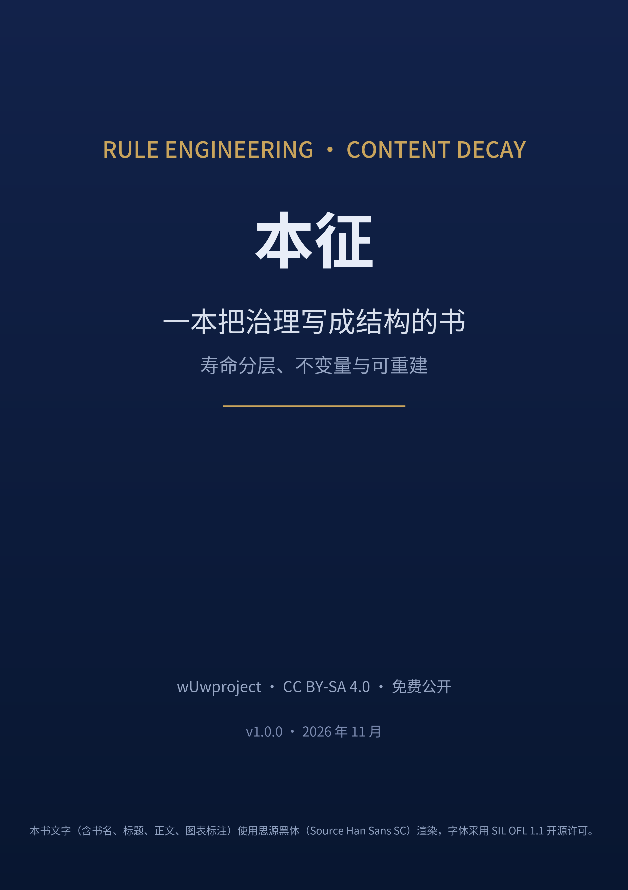

<!--
SPDX-License-Identifier: CC-BY-SA-4.0
Copyright (c) 2026 wUwproject
-->

# Maby Report — 报告与方法论成书

> **成书在此，方法在其中。**
>
> wUwproject 的报告与成书仓库。本仓库只收两类内容：单篇与成书（book）。规划、任务地图、方案、构建脚本一律不入库。
> 协议：各书按各自版权页标注；当前《本征》采用 **CC BY-SA 4.0**，与系列其他书一致。

## 收录的书

<table>
  <tr>
    <td width="240" align="center"><a href="本征/README.md"></a></td>
    <td width="240">&nbsp;</td>
    <td width="240">&nbsp;</td>
  </tr>
  <tr>
    <td align="center"><strong>本征</strong><br>一本把治理写成结构的书：寿命分层、不变量与可重建</td>
    <td>&nbsp;</td>
    <td>&nbsp;</td>
  </tr>
  <tr>
    <td align="center">回答"怎么让规矩活到该活的时候"</td>
    <td>&nbsp;</td>
    <td>&nbsp;</td>
  </tr>
</table>

| 书 | 状态 | 篇幅 | 协议 |
|---|---|---|---|
| [本征](本征/README.md) | 已出片（19 章 · 57,084 字 · PDF 116 页） | 15 篇正文＋版权页／序言／阅读指南／结语／附录 A | CC BY-SA 4.0 |

**在线阅读**：<https://ldxs001.github.io/maby_report/>（书入口页 → 在线阅读整本书）。字数口径：汉字＋英文单词＋数字串，图块与图注不计字，与《我思故我写》《我写故我播》一致。

## 仓库定位

maby_report 与 maby_agent、maby_skills、maby_tool 平级：后三者分别托管智能体、技能与工具，本仓库托管**成书与报告**。2026-11-22 建立，本征为第一个项目。

**入库白名单（硬约束）**：每个项目下只有 `单篇/`（可独立阅读的正文）与 `book/`（成书成品：HTML／PDF／封面）两处；仓库根的 `index.html` 是 GitHub Pages 站点入口，属唯一例外。其余一律不推——写作规划、原稿、内部规范包、工具脚本（`*.py`）、证据底账、名词表、检查记录、任务过程文件与备份目录。这些留在作者本地工作区，不进公开仓库。

## 协议说明

本仓库的 LICENSE 为 **CC BY-SA 4.0**（署名—相同方式共享 4.0 国际）全文，与《我思故我写》《我写故我播》一致：

- **BY 署名**：转载与演绎须注明作者与出处。
- **SA 相同方式共享**：演绎作品须以同等条件协议发布。
- 无 NC 限制：允许商业使用，保障最大范围的传播与再利用。

协议一经适用不可撤销，详见 LICENSE 全文。

## 目录结构

```
maby_report/
├── LICENSE                    # CC BY-SA 4.0 协议全文
├── README.md                  # 本文件（仓库门面）
├── index.html                 # GitHub Pages 入口页：封面＋在线阅读／下载
└── 本征/
    ├── README.md              # 书页：封面、篇目、获取、字数口径
    ├── 单篇/                  # 15 篇正文（00–14）
    └── book/                  # 成书：HTML / PDF / 封面三件套
```

## 维护约定

- Gitee 为主、GitHub 为备，双平台同步，分支 `main`
- 每加一本书，在本文件"收录的书"加一行，并建同名项目目录（只含 `单篇/` 与 `book/`）
- 入库前扫描隐私：真实姓名、邮箱、电话、本机绝对路径不得进入任何文件
